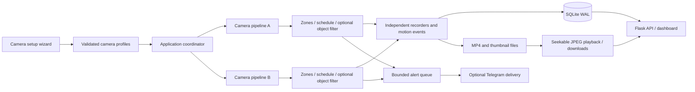

# Architecture — 0.3 preview

Sentinel is a local appliance with a desktop launcher, threaded HTTP API, one independently paced worker per configured camera, and a bounded background alert worker. Windows and Linux are the supported release targets.

## Camera ownership

`CameraManager` discovers local devices and owns their capture handles and database IDs. Drivers choose DirectShow on Windows and the platform backend on Linux. Each capture has its own lock. Reading a slow device does not hold the manager-wide lock or serialize other camera workers.

`CameraPipeline` owns a detector, motion event manager, recorder and latest-frame stream for one profile. Capture/motion/recording state is never shared between feeds. Settings apply after restart. The coordinator performs periodic reconnect, retention, disk pressure and optional update checks. OpenCV defaults to one internal thread to avoid competing thread pools across pipelines.

The profile determines FPS, resolution, motion threshold, recording mode, segment length, zones and schedule. Global recording enabled is a master switch. Detection warms its background model before triggering; cooldown uses elapsed time. Motion event updates are throttled to once per second and finalized on shutdown.

## Reliability and storage

Telegram messages use a bounded queue, per-camera cooldown and limited background retries. Queue saturation drops alerts and increments diagnostics rather than stopping capture. Shutdown drains briefly, then stops waiting for network delivery.

Recorders persist metadata after file finalization, save a thumbnail, associate motion events and rotate long recordings into bounded segments. Cleanup skips active videos/symlinks, removes companion images and marks missing recordings deleted in SQLite. A startup reconciliation repairs stale archive entries after offline file removal. Filesystem deletion and database updates are not a single transaction; the next reconciliation recovers interrupted cleanup.

## HTTP and review

API sessions are request-scoped. SQLite uses WAL and separate pooled connections. Private routes enforce configured authentication; JSON writes use a custom header and origin checks. Archive pagination and analytics use bounded queries and SQL aggregates.

Live frames are JPEG-encoded once per published frame/quality and shared by readers. Browser polling does not overlap requests and pauses in hidden tabs. Historical playback decodes local MP4 to JPEG frames on demand, with four cached decoders and a two-minute idle lifetime. This avoids requiring browser support for MPEG-4 Part 2. Review preview targets 5 FPS; originals retain recording FPS. Recordings have no audio.

## Extension limits

Profiles support up to eight local built-in/USB devices, subject to measured hardware capacity. There is no RTSP provisioning, cloud storage, user-role system or automatic software installation. Built-in HOG detects people; a user-supplied compatible local COCO ONNX model enables person/vehicle filtering. Inference runs in its camera worker and can reduce that feed's FPS. Model accuracy and real-world capacity require separate testing.
