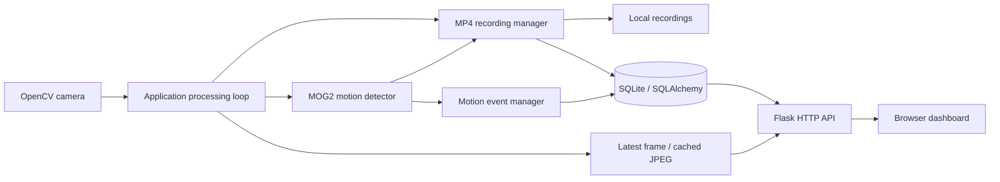

# Architecture

Sentinel is a single-process Python application with a camera processing loop and a threaded local HTTP server. `desktop.py` supplies a Tk launcher; `app.py` owns manager initialization and shutdown. `monitor.py` and `watchdog.py` remain optional external supervisors.

## Ownership and threading

The application loop captures BGR frames, detects motion, manages event transitions, writes recordings and publishes a frame copy. The streaming manager encodes once per published frame/quality, reusing the result for multiple readers under a lock. Browser polling uses a new timeout only after the previous request finishes and pauses in hidden tabs. Frames use HTTP JSON/base64 JPEG, not WebSockets.

Recording metadata is inserted once after OpenCV closes the file. Duration is frames/FPS; event duration uses UTC wall time. Recording paths are organized by UTC year/month/day/camera. SQLite uses WAL and separate pooled connections for concurrent sessions. API sessions are request-scoped and closed during teardown. Index names are unique across the SQLite schema.

Storage cleanup uses the configured recordings volume, excludes symbolic links and the active recording, and removes oldest files at critical capacity. Retention runs periodically using monotonic elapsed time. Cleanup and file deletion are not a transactional database operation; historical metadata can outlive a deleted video.

## Lifecycle

Configuration → paths/logging → database → camera → motion → recording → storage → alerts → streaming → HTTP server. Missing camera is a degraded state. Shutdown stops HTTP, finalizes the recorder, disconnects cameras and disposes database connections. The desktop UI waits for the worker to finish before closing. Configuration edits are validated, persisted atomically and applied on restart.

## Extension points

`CameraDriver` and `RecorderDriver` define driver interfaces. Current automatic discovery uses camera index 0. The application has one active detector/recorder/preview pipeline; multiple independent camera feeds, RTSP provisioning, AI inference and multi-user access are future work. Placeholder packages are retained for compatibility and excluded from release package discovery where unused.
