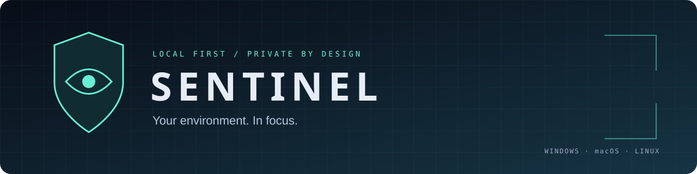

<p align="center"></p>

<p align="center">
  <a href="https://github.com/orpheusdark/sentinal/actions/workflows/verify.yml"></a>
  <a href="https://github.com/orpheusdark/sentinal/releases"></a>
  <a href="LICENSE"></a>
  <a href="pyproject.toml"></a>
</p>

<p align="center">Local camera surveillance with motion recording, a responsive dashboard, and a desktop launcher.<br>Keep your video on your own device. Optional Telegram alerts send event metadata.</p>

<p align="center"><a href="#download">Download</a> · <a href="docs/README.md">Documentation</a> · <a href="docs/INSTALLATION.md">Installation</a> · <a href="docs/SECURITY.md">Security</a> · <a href="CONTRIBUTING.md">Contribute</a></p>

## Download

**[Sentinel 0.2.0 Preview 1](https://github.com/orpheusdark/sentinal/releases/tag/v0.2.0-preview.1)** is an unsigned preview release. Python is bundled in the desktop packages.

| Platform | Download | Start |
|---|---|---|
| Windows x64 | [Setup executable](https://github.com/orpheusdark/sentinal/releases/download/v0.2.0-preview.1/Sentinel-Setup-Windows.exe) | Run setup → Install Sentinel → Open Sentinel |
| Windows x64, portable | [Portable ZIP](https://github.com/orpheusdark/sentinal/releases/download/v0.2.0-preview.1/Sentinel-Windows-portable.zip) | Extract everything; open `Sentinel/Sentinel.exe` |
| macOS, Apple Silicon | [Application ZIP](https://github.com/orpheusdark/sentinal/releases/download/v0.2.0-preview.1/Sentinel-macOS-AppleSilicon.zip) | Extract `Sentinel.app`; distribution signing/notarization remains pending |
| Linux x86-64 | [Application archive](https://github.com/orpheusdark/sentinal/releases/download/v0.2.0-preview.1/Sentinel-Linux-x86_64.tar.gz) | Extract; run `./Sentinel/Sentinel` |

Verify downloads with [SHA-256 checksums](https://github.com/orpheusdark/sentinal/releases/download/v0.2.0-preview.1/SHA256SUMS.txt). See [installation requirements](docs/INSTALLATION.md) and [release notes](docs/releases/0.2.0-preview.1.md) before deploying.

## What Sentinel does

- **Monitor locally:** live camera preview, connection status, recording state and CPU/memory/disk telemetry.
- **Capture activity:** OpenCV motion detection, motion-triggered or continuous MP4 recording, and a configurable post-motion tail.
- **Review recordings:** filter the archive, browse pages and download finalized videos.
- **Manage storage:** configurable retention and disk-pressure cleanup, with active recordings protected.
- **Configure clearly:** validated settings, explicit restart requirements and environment overrides.
- **Stay informed:** optional Telegram startup, shutdown and motion alerts.

The dashboard uses responsive layouts, keyboard focus indicators, labeled controls and reduced-motion styling. The desktop launcher starts, opens and stops the local service. Private data is kept separately from application binaries.

## Quick start

1. Download the package for your operating system and architecture.
2. Open the launcher and choose **Start Sentinel**.
3. The dashboard opens at `http://127.0.0.1:5000`.
4. Review settings, then restart Sentinel after saving changes.

Missing cameras appear as a disconnected state while the dashboard remains accessible. Network access requires configured authentication; use TLS and restricted network access for remote viewing. Phones and tablets can use the responsive browser dashboard of a secured host. Native Android/iOS camera-server apps are not included.

## Run from source

Requires Python 3.11+, a modern browser and compatible camera drivers. Linux desktop use may need Tk/OpenCV system libraries.

```sh
git clone https://github.com/orpheusdark/sentinal.git
cd sentinal
python -m venv .venv
```

Windows:

```powershell
.\.venv\Scripts\python -m pip install -r requirements.txt
.\.venv\Scripts\python desktop.py
```

macOS / Linux:

```sh
.venv/bin/python -m pip install -r requirements.txt
.venv/bin/python desktop.py
```

Convenience launchers: `scripts/start-windows.bat` or `sh scripts/start-unix.sh`. Headless operation: `python app.py --config config/local.json` after installing dependencies.

## Documentation

| Use Sentinel | Understand and extend it |
|---|---|
| [Installation](docs/INSTALLATION.md) | [Architecture](docs/ARCHITECTURE.md) |
| [Configuration](docs/CONFIGURATION.md) | [API reference](docs/API.md) |
| [Features and limits](docs/FEATURES.md) | [Testing](docs/TESTING.md) |
| [Deployment](docs/DEPLOYMENT.md) | [Desktop packaging](docs/PACKAGING.md) |
| [Troubleshooting](docs/TROUBLESHOOTING.md) | [Audit and remaining work](docs/AUDIT.md) |
| [Security](docs/SECURITY.md) | [Changelog](docs/CHANGELOG.md) |

The [documentation index](docs/README.md) links all current guides. Historical phase notes are retained as development history.

## Verification and release status

The final local application test run passed **92 tests**, including basic webcam checks. GitHub verification passed on Windows, macOS and Linux with Python 3.11 and 3.12. Native builds and frozen-resource checks passed on all three platforms. See [recorded verification and limitations](docs/VERIFICATION.md).

This preview still needs full GUI installation, real-world recording/cleanup soak tests and browser visual acceptance. Desktop packages do not have distribution signing. Independent multi-camera pipelines, AI detection, cloud backup and automatic updates are future work.

## Development

```sh
python -m pip install -r requirements-dev.txt
python -m pytest -q
python -m ruff check .
python -m build
```

Build native applications with `python scripts/build_desktop.py` on the target OS. The [desktop workflow](https://github.com/orpheusdark/sentinal/actions/workflows/desktop.yml) builds platform archives and checks bundled resources. Read [contribution guidance](CONTRIBUTING.md) before opening a pull request.

## Support and license

[Report a bug](https://github.com/orpheusdark/sentinal/issues/new/choose), [request a feature](https://github.com/orpheusdark/sentinal/issues/new/choose), or consult [support guidance](SUPPORT.md). Report security concerns using [the security policy](SECURITY.md).

Sentinel is released under the [MIT License](LICENSE). Third-party libraries retain their own licenses; release downloads include a separate license bundle.
